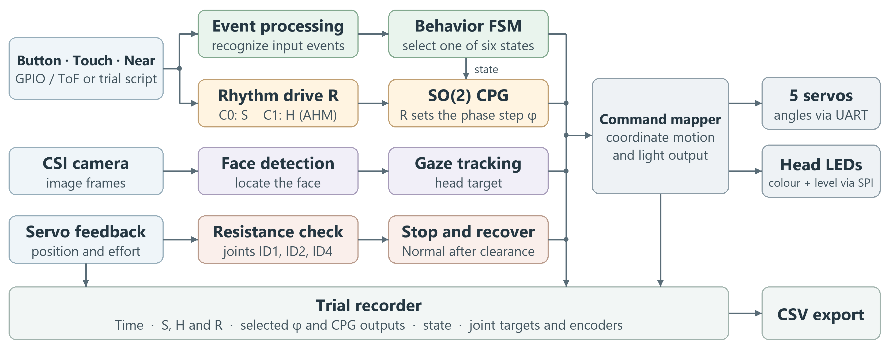
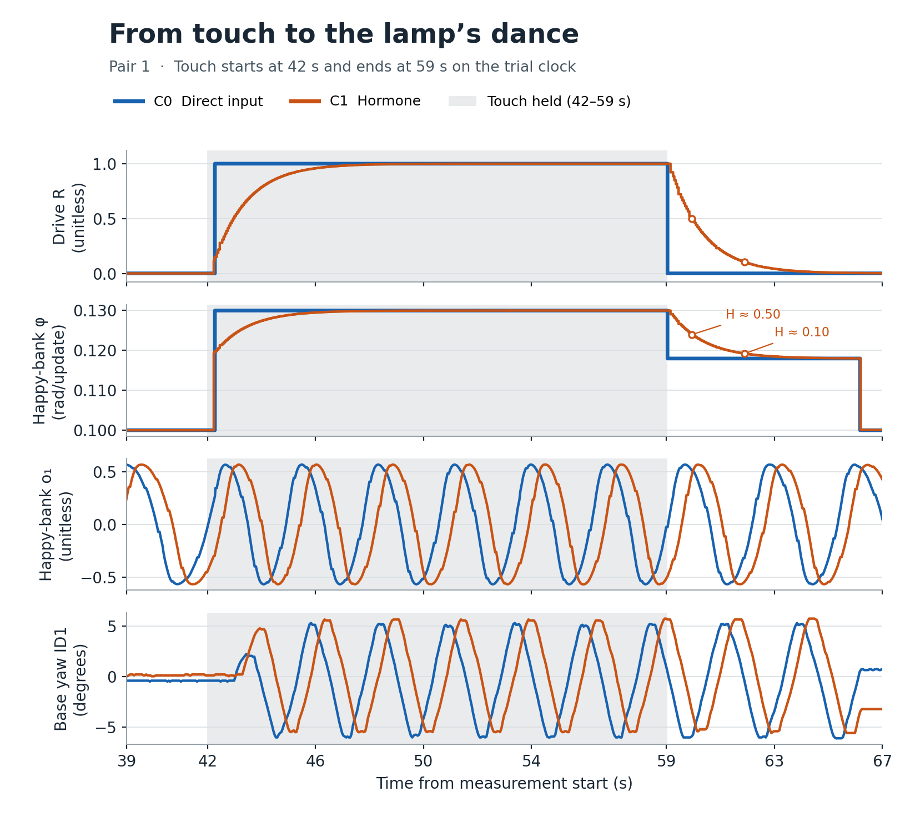
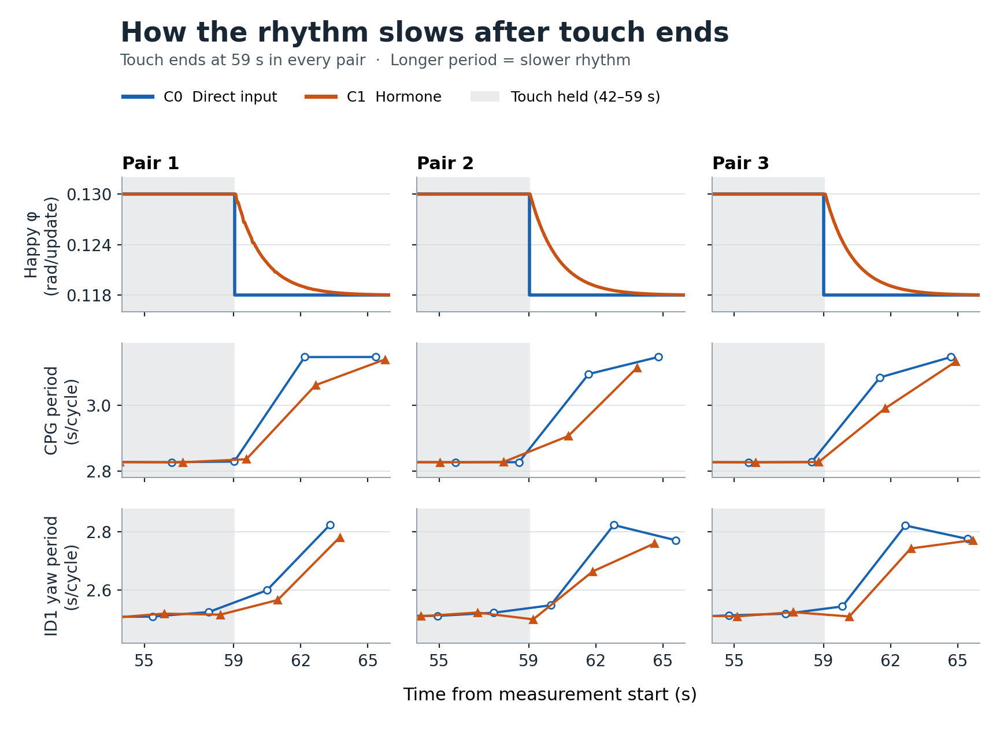
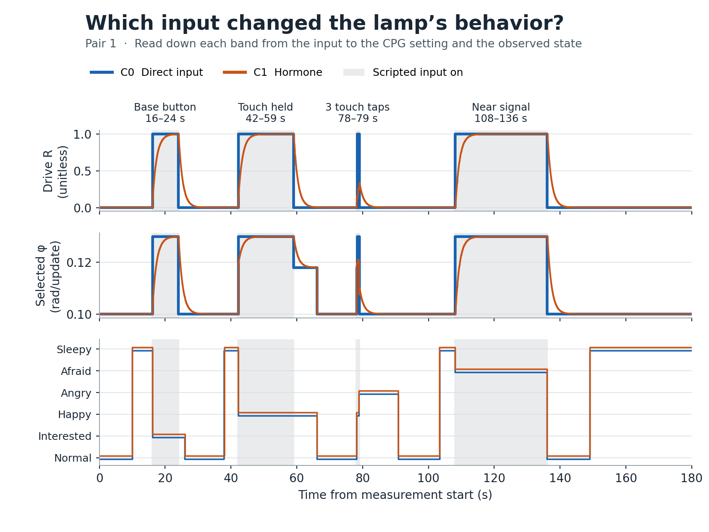

# ใบงานปฏิบัติการ Lab 07 ROS 2 และการออกแบบการทดลอง

รายวิชา 1353410 Biological Sensing and Sensorimotor Control | Week 07 | ฉบับนักศึกษา

ศึกษาการรับส่งและบันทึกข้อมูลผ่าน ros 2 ร่วมกับการทดลองเปรียบเทียบผลของสิ่งเร้าและฮอร์โมนต่อจังหวะ cpg ของโคมหุ่นยนต์ โดยทดลองบนหุ่นจริง บันทึกข้อมูลการเคลื่อนไหว และวิเคราะห์ผลการทดลอง

| ชื่อกลุ่ม | กลุ่ม 7 |
| --- | --- |
| สมาชิก | 1.นางสาวธมนันท์ ลิ้มอิ่ม รหัสนักศึกษา 66525002482.นาย ธนวัฒน์ อ่อนดำ รหัสนักศึกษา 6652500256 |
| วันที่ทดลอง | 12/11/2569 |

## ระบบโคมหุ่นยนต์

### กำหนดกิจกรรมในคาบ 180 นาที

| เวลาในคาบ 180 นาที | กิจกรรม |
| --- | --- |
| 0 ถึง 30 | ROS 2 graph และ node |
| 30 ถึง 60 | Topics messages และ units |
| 60 ถึง 90 | micro ROS และ ESP32 |
| 90 ถึง 120 | Research question และ hypothesis |
| 120 ถึง 155 | Experimental design และ repeatability |
| 155 ถึง 180 | Proposal clinic และ exit quiz |

ช่วง 60–90 นาทีเป็นเนื้อหารายวิชา สำหรับโคมของกลุ่ม Raspberry Pi 5 อ่านเซนเซอร์และส่งคำสั่งไปยังอุปกรณ์โดยตรง

### ระบบรับสิ่งเร้า เลือกท่าทาง และสั่งมอเตอร์อย่างไร

บน Raspberry Pi 5 โปรแกรมอ่านปุ่มและสัมผัสผ่าน GPIO อ่านระยะจาก ToF ผ่าน I²C และรับภาพจากกล้อง CSI ตัวถอดจังหวะส่งเป้ามอเตอร์ผ่านผู้ควบคุม UART เพียงตัวเดียวไปยังเซอร์โวทั้งห้าข้อ FSM เลือกท่าและสีของไฟ LED 16 ดวง ส่วนเฟส CPG กำหนดความสว่างผ่าน SPI ตัวบันทึกบน Pi เก็บเป้าท่าและมุมที่ encoder อ่านได้

### ส่วนใดเก็บสถานะ และเหตุใดต้องใช้ทั้ง AHM และ SO(2) CPG

ตัวกรองอินพุตเก็บระดับและขอบสัญญาณ FSM เก็บสถานะกับเวลา AHM เก็บผลของสิ่งเร้าไว้ใน H ส่วน SO(2) CPG เก็บ o₁ และ o₂ เพื่อสร้างจังหวะซ้ำ กลุ่มเลือกให้ H ปรับ φ ของ CPG และให้เหตุการณ์กำหนดท่าผ่าน FSM สมาชิกทั้งสองคนดูแลระบบร่วมกัน

ในการจำลอง โปรแกรมใช้ลำดับสถานะและช่วงที่จังหวะทำงานจากรอบ C0 ของแต่ละคู่ แล้วคำนวณสัญญาณตัวควบคุมใหม่ บนโคมจริงใช้ encoder ตรวจการเคลื่อนไหวของมอเตอร์

### ก่อนใช้หุ่นจริงต้องสอบเทียบและตรวจความปลอดภัยอย่างไร

ตั้งท่า Normal เป็นศูนย์อ้างอิง ตรวจทิศหมุนและขอบมุมของแต่ละข้อ ทดสอบการหยุดเมื่อพบแรงต้านที่ ID1, ID2, ID4 และจัดสายให้พ้นแนวเคลื่อน เคยมีรอบที่ต้องหยุดเพราะโคมสัมผัสสายด้านหลังขณะอยู่ในท่า Afraid

[ผังระบบฉบับแก้ไขได้](../04_Design/Lamp_data_flow.mmd) · [วงจรไฟฟ้า LampBio-Inpire](../04_Design/LampBio-Inpire_Wiring_User_Final.jpg)

## กราฟ ROS 2 และสัญญาของ 13 topics

### แบบฝึก ROS 2 แบ่งสามบทบาทอย่างไร

### /week07_inputs → /week07_interaction → /week07_output_collector

โหนดแรกส่งอินพุต 3 หัวข้อให้โหนดกลางแปลเหตุการณ์และอัปเดต FSM โหนดสุดท้ายรับเอาต์พุต 4 หัวข้อ แบบฝึกบน WSL ใช้ ROS 2 Jazzy และอินพุตสังเคราะห์ rosbag บันทึกครบ 7/7 หัวข้อ รวม 7,425 ข้อความ

### หน้าที่ของสามโหนดและหลักฐานที่บันทึก

| บทบาท | สิ่งที่ส่งหรือรับ และหลักฐานเวลาที่เก็บได้ |
| --- | --- |
| synthetic_inputs | ส่ง input/button และ input/touch เป็น Bool ส่ง input/distance เป็น Float32 หน่วยเมตร เก็บเวลาอ่านและเวลา publish ในไฟล์ประกอบของผู้ส่ง |
| interaction | รับสามอินพุต ประมวลผล event และ FSM ส่ง interaction, emotion, servo_command และ rgb_command เก็บเวลา receive และ publish ที่ node นี้ |
| output_collector | รับสี่เอาต์พุตและเก็บเวลาที่ข้อความมาถึง จึงตรวจปลายทางของคำสั่งได้ การเริ่มขยับจริงต้องวัดที่ตัวมอเตอร์ |

### แต่ละ topic ใช้ชื่อ ชนิด หน่วย และ QoS อะไร

เจ็ดแถวแรกเป็นหัวข้อตามสัญญารายวิชา อีกหกแถวเป็นส่วนที่กลุ่มออกแบบเพิ่ม คอลัมน์สุดท้ายระบุหน้าที่ในโคม ทั้ง 13 หัวข้อกำหนด QoS เป็น RELIABLE, KEEP_LAST depth 10 และ VOLATILE

| Topic | ชนิดข้อความ ROS 2 | หน่วยหรือความหมาย | ผู้ส่ง → ผู้ใช้ในโคม |
| --- | --- | --- | --- |
| /lamp/input/button | std_msgs/msg/Bool | ปุ่มกด (bool) | Sensor → Interaction |
| /lamp/input/touch | std_msgs/msg/Bool | สัมผัส (bool) | Sensor → Interaction |
| /lamp/input/distance | std_msgs/msg/Float32 | ระยะที่วัดได้ (m) | Sensor → Interaction |
| /lamp/interaction | std_msgs/msg/String | ชื่อเหตุการณ์ | Interaction → FSM, AHM |
| /lamp/emotion | std_msgs/msg/String | ชื่อสถานะ | FSM → CPG, Decoder |
| /lamp/servo_command | std_msgs/msg/Float32MultiArray | มุม (rad) | Decoder → ตัวอ่านคำสั่ง |
| /lamp/rgb_command | std_msgs/msg/ColorRGBA | RGBA 0–1, a = 1 | Emotion → ตัวอ่านสี |
| /lamp/input/status | std_msgs/msg/String | คุณภาพและขอบสัญญาณ | Sensor → Logger |
| /lamp/ahm_cpg/diagnostic | std_msgs/msg/String | S, H, R, φ, o₁, o₂ | AHM, CPG → Logger |
| /lamp/joint_states | sensor_msgs/msg/JointState | มุม 5 ข้อ (rad) | Encoder → Logger |
| /lamp/perception/face | std_msgs/msg/String | กรอบใบหน้าและเวลา | Camera → Gaze, Logger |
| /lamp/diagnostics | diagnostic_msgs/msg/DiagnosticArray | สถานะ, V, °C | Owner → Logger |
| /lamp/trace | std_msgs/msg/String | เหตุการณ์และเวลา | Owner, FSM → Logger |

ไฟล์ native บน Pi มีข้อมูลอย่างน้อยบางช่วงใน 12/13 กลุ่มของแต่ละรอบหุ่นจริง ส่วนกรอบใบหน้าไม่มีบันทึกรายเฟรมต่อเนื่องตลอด 180 วินาที

[สัญญา 7 หัวข้อของอาจารย์](https://github.com/potiwat/RAE67_bio_ins/blob/fa528b169f1127ee3e0e9fae3d721546bf1b82d2/lab_07/interface_contract.json) · [สัญญาของโคม 13 หัวข้อ](../04_Design/TOPIC_CONTRACT_13.json) · [ข้อมูลที่พบรายหัวข้อ](../04_Design/TOPIC_COVERAGE.csv) · [ผล rosbag บน WSL](../03_Results/course_ros/message_counts.csv)

### การส่งข้อความและเกณฑ์ตรวจข้อมูลเก่า

| กลุ่มข้อมูล | สิ่งที่ตรวจเมื่อรับ |
| --- | --- |
| Sensor และสถานะอินพุต | ตรวจเวลาที่อ่านจริง คุณภาพ และลำดับตัวอย่าง ระยะที่วัดไม่ได้ให้ส่งสถานะกำกับ |
| Interaction และ emotion | เทียบ source_id, event_id และเวลาที่รับรู้กับสถานะของ FSM |
| Servo และ RGB command | ตรวจลำดับข้อต่อ หน่วย และช่วงสี เวลาของคำสั่งเป็นคนละจุดวัดกับการเคลื่อนที่หรือไฟติด |

### ถ้าไม่มีข้อความ จะตรวจชนิดข้อมูลและ QoS อย่างไร

ใช้ ros2 topic list -t เทียบชนิดข้อความ แล้วใช้ ros2 topic info /lamp/emotion --verbose เทียบ QoS ของสองฝั่ง ในแบบฝึกตัวส่งและตัวควบคุมอัปเดตทุก 0.02 s ข้อมูลผิดหรืออายุเกิน 0.12 s ทำให้ FSM กลับ Normal โดย offline นับอายุจากเวลาเก็บตัวอย่าง ส่วน WSL นับจากเวลารับ

## การวัดคำสั่ง เวลา และผลการทดสอบ bridge

### เส้นทางจากเซนเซอร์ถึงมอเตอร์และตัวบันทึกบน Pi 5

| องค์ประกอบ | เส้นทางข้อมูลที่ใช้กับโคมจริง |
| --- | --- |
| Sensor และการรู้จำ | Pi รับขอบสัญญาณปุ่มกับสัมผัส อ่านระยะและคุณภาพจาก ToF และติดตามเป้าด้วยกล้อง ช่วงเก็บ 180 s มีสิ่งเร้าตามตารางกำกับ |
| FSM, AHM และ SO(2) CPG | FSM เลือกหนึ่งในหกสถานะ H และแหล่ง R กำหนด φ ตัวกำเนิดจังหวะส่งสัญญาณให้ตัวถอดท่าทาง |
| มอเตอร์และไฟ | ผู้ควบคุม UART เพียงตัวเดียวส่งเป้ามอเตอร์ STS3215 และอ่าน encoder ห้าข้อ ไฟบนหัวโคม 16 ดวงรับผ่าน SPI ใช้สีตามสถานะและปรับความสว่างตามเฟส CPG |
| Safety และ recorder | Safety ตรวจแรงต้านที่ ID1, ID2, ID4 ตัวบันทึกบน Pi เก็บเหตุ STOP การคืนท่า และช่วงตัวควบคุมใหม่ แยกคำสั่งจาก feedback ที่อ่านได้จริง |

### จะแปลงคำสั่งมอเตอร์และสีอย่างไร

คำสั่งมอเตอร์เรียง [tilt, extend, nod] ตรงกับ ID4, ID2, ID5 เป็นมุมเทียบกับท่า Normal หน่วย rad ตัวอย่าง C0 seed 41 ที่ 1.14 s ส่ง [0.016, 0.016, 0.016] rad และสี Interested จาก RGB [255, 180, 0] หารด้วย 255 เป็น RGBA [1, 0.7059, 0, 1]

### เวลาใดจับคู่กันได้ และต้องวัดเพิ่มอะไรเพื่อหาเวลาขยับหรือไฟติด

แบบฝึก offline จับคู่ source_id กับเวลาเริ่มสิ่งเร้า เวลารับ และเวลาที่คำสั่งมีผลบนนาฬิกาเสมือนเดียวกัน ข้อความบน ROS ทั้งเจ็ดหัวข้อไม่มี Header จึงทราบเวลารับบน WSL จากบันทึก perf_counter_ns แต่ระบุตัวอย่างต้นทางจากค่าที่ซ้ำกันไม่ได้

บน Pi จับคู่ source_id กับเวลารับรู้และสั่งงานบน CLOCK_BOOTTIME แล้วใช้จุดเทียบเวลากับ CLOCK_MONOTONIC ของ encoder การวัดเวลาถึงการขยับหรือไฟติดจริงต้องกำหนดเกณฑ์เริ่ม วัด encoder หรือแสง และเทียบนาฬิกาหาค่าเหลื่อมพร้อมความคลาดเคลื่อน ชุดนี้ยังไม่มีค่าความหน่วงถึงเอาต์พุตทางกายภาพที่สอบเทียบแล้ว

### จุดที่ประทับเวลาและขอบเขตการวัด

| จุดวัด | นาฬิกาและหลักฐานที่ใช้ |
| --- | --- |
| สิ่งเร้าเข้าตัวควบคุม | บันทึกเวลาเหตุการณ์ที่โปรแกรมกำหนดบน Pi และ source_id เช่น study_touch_42.0 แยกจากขอบ GPIO จริง |
| FSM รับรู้และเลือกท่า | จับคู่ ID ของเหตุการณ์ เวลารับรู้ และเวลา dispatch บนนาฬิกาของตัวควบคุม Pi (CLOCK_BOOTTIME) |
| สัญญาณ CPG | สร้างเวลาเอาต์พุตจากจำนวนอัปเดต × 0.05 s ÷ time_scale ของตัวกำเนิดที่เลือก |
| มุมหรือคาบมอเตอร์ | ใช้เวลาตัวอย่าง encoder ของแต่ละข้อ (CLOCK_MONOTONIC) คำนวณคาบจากการตัดมุมกึ่งกลางในทิศเดิม |
| เวลาเริ่มขยับหรือไฟติด | ต้องกำหนดเกณฑ์ onset และความไม่แน่นอน สอบเทียบกับ encoder หรือภาพพร้อมจุดอ้างอิงเวลา ชุดนี้ยังไม่มีค่า source-to-physical onset ที่สอบเทียบ |

### เมื่อเปลี่ยนการส่งข้อความ คำสั่งเคลื่อนไหวและสีมาทันกี่เหตุการณ์

นโยบายแบบฝึกใช้ 5 สถานะ ได้แก่ normal, interested, happy, afraid และ sleepy กับ 8 เหตุการณ์ ได้แก่ button, touch, approach, near, clear, timeout, idle และ fault

ก่อนรันคาดว่า C1 จะพลาดมากขึ้น แต่ละคู่ใช้ policy และอินพุตเดียวกัน รอบละ 22 s แบบ C0 ส่งตรง ส่วน C1 หน่วง 0–0.18 s มีโอกาสตก 0.08 และมีช่วงตกติดกันที่ 12.50–12.70 s จึงวัดได้เฉพาะผลรวมของการหน่วงและการตกหล่น ทั้งคู่มีการทดสอบอินพุตผิดหรือเก่า แม้ใน C0 ก็พบ fault 20 จาก 1,101 ticks แบ่งเป็นระยะผิด 7 และ Touch เก่า 13 ticks

ตัวหารคือ 7 ID ที่ประกาศก่อนรัน ได้แก่ button_01, touch_01, approach_01, clear_01, near_01, clear_02 และ button_02 นับว่าผ่านเมื่อพบทั้งคำสั่งมอเตอร์และ RGB ภายใน 1 s จากสิ่งเร้าต้นทาง เวลาคู่ใช้คำสั่งที่มาทีหลัง ค่า Max คำนวณเฉพาะ ID ที่พบครบ

| คู่ / seed | ผ่านจาก 7 C0 / C1 | Max (s) C0 / C1 | ID ที่ขาดใน C1 | ข้อความตก C0 / C1 | กำหนดถึงหลังจบรอบ C0 / C1 |
| --- | --- | --- | --- | --- | --- |
| 1 / 41 | 7 / 6 | 0.14 / 0.20 | clear_02 | 0 / 257 | 0 / 15 |
| 2 / 42 | 7 / 6 | 0.14 / 0.22 | button_02 | 0 / 287 | 0 / 9 |
| 3 / 43 | 7 / 7 | 0.14 / 0.18 | ไม่มี | 0 / 300 | 0 / 12 |

C0 ผ่าน 21/21 และ C1 ผ่าน 19/21 คงสอง ID ที่ขาดในตัวหารและให้เวลาเป็น N/A นโยบายของกลุ่มผ่านการตรวจ 40/40 คู่สถานะ–เหตุการณ์ (SHA-256 ย่อ 2a7d07a3cf68)

[เกณฑ์ก่อนรัน](../03_Results/course_bridge/preregistered_protocol.json) · [policy ของกลุ่ม](../03_Results/course_bridge/runtime/completed_policy.py) · [คำสั่งรันและผลตรวจ](../03_Results/course_bridge/README_TH.md) · [ผลราย ID](../03_Results/course_bridge/primary_outcomes.csv) · [config](../03_Results/course_bridge/runs_20261112/C1_r02/config.json) · [input trace](../03_Results/course_bridge/runs_20261112/C1_r02/input_trace.csv) · [command trace](../03_Results/course_bridge/runs_20261112/C1_r02/command_trace.csv) · [events](../03_Results/course_bridge/runs_20261112/C1_r02/events.csv) · [manifest](../03_Results/course_bridge/runs_20261112/manifest.json)

## คำถามวิจัย สมการ และวิธีทดลอง

### การให้ฮอร์โมน H ปรับ φ แทนสิ่งเร้า S เปลี่ยนความถี่และความต่างระหว่างคาบ CPG อย่างไร และฐานโคมส่ายตามหรือไม่

C0 ใช้ R = S โดยตรง ส่วน C1 ใช้ R = H ที่สะสมจากสิ่งเร้า คาดว่าหลังปล่อย Touch ค่า H จะค่อย ๆ ลด ทำให้ C1 รักษาจังหวะเร็วไว้ชั่วคราว ทั้งสองเงื่อนไขใช้ FSM, ตัวกำเนิดจังหวะ ท่าทาง และค่าตั้งมอเตอร์ชุดเดียวกัน

### ตัวแปรต้น ตัวแปรตาม และเงื่อนไขควบคุม

| ตัวแปร | นิยามของกลุ่ม |
| --- | --- |
| ตัวแปรต้น | แหล่งของ R ที่ใช้ปรับ φ เงื่อนไข C0 ใช้ R = S โดยตรง เงื่อนไข C1 ใช้ R = H ทั้งสองฝั่งคำนวณและบันทึก H |
| ตัวแปรตาม | M1 ความถี่ CPG และ M2 ค่าเฉลี่ยความต่างสัมบูรณ์ของคาบที่ติดกัน เสริมด้วยคาบการส่ายฐานจาก encoder ID1 |
| ตัวแปรที่คงที่ | ตารางอินพุต กฎ FSM, α, dt, mapping ของแต่ละตัวกำเนิด ท่าทาง PID โปรไฟล์มอเตอร์ และ Safety ใช้เป้ากล้องเดียวกันภายในคู่ |
| ค่าเริ่ม | เริ่มวัดเมื่อท่า Normal และ H = 0 ทั้ง 6 รอบ เก็บค่า o₁ และ o₂ ของแต่ละตัวกำเนิดแยกรอบ เฟสเริ่มต้นบนหุ่นจริงอาจต่างกัน |

| ส่วน | สมการและพารามิเตอร์ |
| --- | --- |
| AHM (Lab 4–5) | Hₖ₊₁ = clip(Hₖ + 0.05 × (0.8Sₖ − 0.8Hₖ), 0, 1) โดย dt = 0.05 s และ S, H, R ไม่มีหน่วย |
| SO(2) CPG (Lab 3) | o₁′ = tanh[α(cos φ · o₁ + sin φ · o₂)] และ o₂′ = tanh[α(−sin φ · o₁ + cos φ · o₂)] ใช้ o₁, o₂ คู่เดิมคำนวณทั้งสองค่า โดย α = 1.10 |
| การเชื่อม AHM–CPG | ตัวกำเนิดพื้นฐานใช้ φ = 0.10 + 0.03R เฉพาะ Happy ใช้ φ = 0.1179805 + (0.1300000 − 0.1179805)R หน่วย rad/update |

### เงื่อนไขที่เปลี่ยนและสิ่งที่คงที่

| เงื่อนไข | สิ่งที่ใช้กำหนดจังหวะ | สิ่งที่คงที่ภายในคู่ |
| --- | --- | --- |
| C0 | R = S ตามสิ่งเร้าโดยตรง | ตารางสิ่งเร้า เป้ากล้อง ท่าทาง PID และค่าเริ่ม H = 0 |
| C1 | R = H ตามฮอร์โมนที่สะสมและสลาย | ใช้เงื่อนไขเดียวกับ C0 และบันทึก H ทั้งสองรอบ |

## Protocol ตัวชี้วัด และการวัดซ้ำ

### จะให้สิ่งเร้าเหมือนกันและวัดซ้ำอย่างไร

ใช้โคมจริงตัวเดียว 3 คู่ รวม 6 รอบ รอบละ 180 s เริ่มที่ท่า Normal และ H = 0 บันทึกเฟสจริงของ CPG แต่ละรอบ พักอย่างน้อย 60 s ภายในคู่ P1 กล้องมองผู้เล่นจริง ส่วน P2–P3 กล้องจริงมองภาพใบหน้าบนจอ โดยคงเป้าเดิมทั้งสองเงื่อนไขของแต่ละคู่

| เวลาในรอบ (s) | สิ่งเร้าที่สคริปต์ป้อน | สถานะที่ติดตาม |
| --- | --- | --- |
| 16–24 | กดปุ่มฐานค้าง | Interested |
| 42–59 | ค้าง Touch แล้วปล่อยที่ 59 s | Happy |
| 78.0, 78.4, 78.8 | Touch สามครั้ง ครั้งละ 0.2 s | Angry |
| 108–136 | เปิดสัญญาณ Near แล้วปล่อยที่ 136 s | Afraid แล้วกลับ Normal |

### ลำดับรอบที่เก็บบนโคมจริง

| คู่ | ลำดับรอบจริง | C0 (แถวดิบ) | C1 (แถวดิบ) |
| --- | --- | --- | --- |
| P1 | C0 → C1 | 3,575 | 3,576 |
| P2 | C1 → C0 | 3,578 | 3,578 |
| P3 | C0 → C1 | 3,579 | 3,578 |

แบบจำลองใช้บริบทและเฟสเริ่มจาก C0 ของคู่เดียวกัน แล้วคำนวณ C0 และ C1 แยกกันอย่างละ 3 รอบ รอบละ 180 วินาที ลำดับในตารางเป็นลำดับการเก็บบนหุ่นจริง

โปรแกรมให้ S = 1 เมื่อปุ่มฐาน การสัมผัส หรือ Near ตามตารางทำงาน และ S = 0 ในช่วงอื่น Pi บันทึก C0 10,732 ตัวอย่าง และ C1 10,732 ตัวอย่าง รวม 21,464 ตัวอย่าง ในจำนวนนี้มีบันทึกปิดรอบ 6 ตัวอย่าง เหลือ 21,458 ตัวอย่างในไฟล์วิเคราะห์ช่วง 0 ≤ t < 180 s

แยกเก็บรอบที่หยุดก่อนกำหนดหรือมีสิ่งเร้าปะปน พร้อมระบุสาเหตุที่คัดออก

[ที่มาของสมการและ SO(2) CPG ของ Dr. Poramate](../06_References/README_TH.md) · [ดัชนีรอบหุ่นจริงและ SHA](../03_Results/real_robot/summary/Run_index.csv) · [รอบที่คัดออกและเหตุผล](../03_Results/real_robot/excluded_attempts.json)

### ตัวชี้วัดและหลักจัดการข้อมูลที่วัดไม่ได้

| ตัวชี้วัด | วิธีวัดและการรายงาน |
| --- | --- |
| M1 ความถี่ CPG (Hz) | 1 / ค่าเฉลี่ยคาบ o₁ ที่วัดได้ในช่วงต่อเนื่องเดียวกัน ต้องมีรอบเต็มอย่างน้อยหนึ่งรอบ |
| M2 ความต่างระหว่างคาบ (s) | เฉลี่ย &#124;Tₙ − Tₙ₋₁&#124; จากคาบเต็มที่ติดกันในช่วงเดียวกัน หากไม่มีคู่ให้รายงาน N/A |
| คาบการส่ายฐาน ID1 (s/รอบ) | ใช้ encoder วัดหนึ่งรอบเต็ม ตัดรอบที่คร่อมเวลาปล่อย Touch ออกจากค่าเฉลี่ย ON/OFF และรายงานจำนวนรอบ |

### การเล่นกับคน 10 นาทีมีหลักฐานอะไร

ชุด present เป็นการสาธิตคนละเซสชันกับรอบ C0/C1 คลิปยาว 632.180 s โคมแสดงครบหกสถานะและมีบันทึกข้อต่อ 64,212 แถว ครอบคลุม 631.926 s ระบบหยุดและกลับมาทำงานระหว่างเล่น ยังไม่ได้เทียบเหตุการณ์ในบันทึกกับวิดีโอแบบตรงเฟรม

### ช่วงการเล่นกับคนตามบันทึกเซสชันสาธิต

ช่วงนาทีอ้างจากเวลาเริ่มบันทึกบน Pi ตารางแสดงสถานะที่หุ่นบันทึกระหว่างเล่น เวลากดปุ่มหรือแตะจริงของผู้เล่นไม่ได้บันทึกครบทุกครั้ง และวิดีโอยังไม่ได้ซิงก์กับ CSV รายเฟรม

| ช่วงนาที | สถานะที่พบ เรียงตามที่พบครั้งแรกในช่วง | คำขอหยุดจากแรงต้าน |
| --- | --- | --- |
| 0–2 | Normal, Afraid, Interested, Happy, Angry, Sleepy | ไม่พบคำขอหยุด |
| 2–5 | Sleepy, Afraid, Normal, Happy, Interested, Angry | ID1, ID4 |
| 5–8 | Normal, Happy, Angry, Sleepy, Interested, Afraid | ID2 |
| 8–10 | Happy, Interested, Normal, Angry, Afraid, Sleepy | ไม่พบคำขอหยุด |

หากระบบแจ้งแรงต้าน ให้ผู้เล่นเอาสิ่งกีดขวางออกและเว้นแนวเคลื่อน หากการเคลื่อนผิดปกติให้หยุดฉุกเฉิน

[คลิปชุด present](../07_Evidence/present/IMG_4568.MOV) · [ชมทาง YouTube](https://youtu.be/-zckfxbT9Jk?feature=shared) · [ข้อมูลข้อต่อ](../07_Evidence/present/present_feedback.csv) · [เหตุการณ์ระหว่างเล่น](../07_Evidence/present/present_events.csv)

### ผลการทดลอง AHM–CPG

### สิ่งเร้าส่งผลถึงฐานโคมอย่างไรในช่วง Happy

รูปที่ 1 คู่ P1 ช่วง 39–67 s แถบเทาคือช่วงค้าง Touch แถวบนลงล่างแสดง R, φ, คลื่น o₁ และมุมฐานจาก encoder ID1 เทียบกับมัธยฐานช่วง 45–59 s เส้นสีน้ำเงินคือ C0 และสีส้มคือ C1 จุดสีส้มชี้ให้เห็นว่าเมื่อปล่อย Touch แล้ว H ยังเหลือประมาณ 0.50 ที่ 0.95 s และ 0.10 ที่ 2.89 s หลังปล่อย

เวลาในรูปนับจากเริ่มรอบทดลอง ขอบแถบเทาที่ 42.000 s คือเวลาที่สคริปต์เปิด Touch ขณะโคมอยู่ใน Sleepy ระบบรับเหตุและเลือก Happy หลังจากนั้น 25 ms ใน C0 และ 29 ms ใน C1 ขั้นตอนเปลี่ยนท่ารวมการยุติการพับตัว เตรียมหัว และตั้งค่ามอเตอร์ โปรแกรมบันทึกว่าขั้นตอนนี้เสร็จที่ 42.268 s และ 42.224 s ตามลำดับ จุดข้อมูล Happy จุดแรกอยู่ถัดมาไม่ถึง 1 ms กราฟแสดงค่าเดิมจนถึงจุดนั้นจึงเห็นช่องหลังขอบเทา เวลาดังกล่าววัดจากโปรแกรม ส่วนความชันของเส้นส้มหลังจุดแรกเกิดจาก C1 ใช้ H ที่ค่อย ๆ สะสม ขณะที่ C0 ใช้สิ่งเร้าโดยตรง

### วัดความถี่และความเปลี่ยนแปลงของคาบอย่างไร

คาบ T วัดระหว่างจุดตัดศูนย์ขาขึ้นของ o₁ สองจุดติดกันบนเวลาเอาต์พุต CPG แทรกเชิงเส้นระหว่างจุดวัดและเลือกเฉพาะช่วงที่สถานะตรงกับท่าที่ทำและเปิดจังหวะเต็ม ตัดช่วงเปลี่ยนท่าหรือช่องว่างเกิน 0.30 s คำนวณ M1 = 1/mean(T) หน่วย Hz เมื่อมีคาบเต็ม และ M2 = mean(|Tₙ − Tₙ₋₁|) หน่วย s เมื่อมีคาบเต็มติดกันในช่วงเดียวอย่างน้อยหนึ่งคู่ ถ้าคาบไม่พอให้เป็น N/A

### ค่าฮอร์โมนและค่า φ ที่วัดหลังปล่อย Touch ในคู่ที่ 1

| หลังปล่อยใน C1 (s) | H ใน C1 | φ ใน C1 (rad/update) | φ ใน C0 (rad/update) |
| --- | --- | --- | --- |
| 0.048 | 1.0000 | 0.13000 | 0.11798 |
| 0.947 | 0.4996 | 0.12399 | 0.11798 |
| 2.892 | 0.1017 | 0.11920 | 0.11798 |

[ตัวอย่าง H และ φ หลังปล่อย Touch](../03_Results/real_robot/summary/Happy_H_phi_samples.csv) · [คาบ CPG รายรอบ](../03_Results/real_robot/summary/CPG_cycles.csv)

### คาบหลังปล่อย Touch ทั้งสามคู่

รูปที่ 2 แต่ละคอลัมน์คือหนึ่งคู่ เมื่อปล่อย Touch ที่ 59 s แถวบนแสดง φ ของ C0 (สีน้ำเงิน) ลดทันทีจาก 0.130 เป็น 0.118 rad/update ส่วน C1 (สีส้ม) ค่อย ๆ ลดตาม H แถวกลางคือคาบ CPG แถวล่างคือคาบการส่ายฐานที่ encoder ID1 วัดจริง แต่ละจุดแสดงคาบที่วัดครบ ณ เวลานั้น จุดยิ่งสูง คาบยิ่งยาวและจังหวะยิ่งช้า หลังปล่อย ฐานใน C1 ยังส่ายเร็วกว่าชั่วคราวทั้งสามคู่ เฉลี่ยแบบให้น้ำหนักแต่ละคู่เท่ากัน C1 อยู่ที่ 2.750 เทียบกับ C0 2.806 วินาทีต่อคาบ โดยวัดได้เพียง 1–2 คาบเต็มต่อรอบ

ตัวอย่างคู่ที่ 1 ใน C0 จุดคาบฐานที่ 60.484 s วัดจากรอบที่เริ่มตั้งแต่ 57.884 s จึงคร่อมเวลาปล่อย Touch ที่ 59 s กราฟวางจุดเมื่อจบรอบและตัดรอบที่คร่อมออกจากค่าเฉลี่ยหลังปล่อย ระยะจากขอบเทาถึงจุดจึงใช้บอกเวลาที่มอเตอร์เริ่มตอบสนองไม่ได้

| คู่ | M1 ใน Happy (Hz) C0 / C1 | M2 ใน Happy (s) C0 / C1 | คาบฐานหลังปล่อย (s) C0 / C1 |
| --- | --- | --- | --- |
| P1 | 0.3427 / 0.3440 | 0.0537 / 0.0535 | 2.824 / 2.781 |
| P2 | 0.3436 / 0.3462 | 0.0537 / 0.0583 | 2.797 / 2.712 |
| P3 | 0.3437 / 0.3453 | 0.0536 / 0.0534 | 2.799 / 2.757 |

M1 เพิ่มทุกคู่ แต่ M2 เพิ่มใน P2 และลดเล็กน้อยใน P1 กับ P3 คาบฐานคำนวณจากมุม ID1 ที่ตัดค่ากึ่งกลางในทิศเดิมสองครั้ง โดยใช้เฉพาะคาบเต็มที่อยู่หลังการปล่อยตลอดคาบ

ในซอฟต์แวร์จำลอง 3 คู่ รอบละ 180 s โดยใช้บริบทจาก C0 ร่วมกันภายในคู่ แต่ละรอบ Happy มี 7 คาบเต็มและ 6 คู่คาบ M1 เฉลี่ยของ C0 / C1 เท่ากับ 0.343372 / 0.345161 Hz และ M2 เท่ากับ 0.053671 / 0.053530 s

[คาบการส่ายฐานจาก encoder](../03_Results/real_robot/summary/Happy_ON_OFF_periods.csv) · [ผล M1/M2 บนหุ่นจริง](../03_Results/real_robot/summary/Worksheet_M1_M2.csv) · [ผล M1/M2 ในซอฟต์แวร์](../03_Results/simulation/Worksheet_M1_M2.csv)

### สิ่งเร้ากับสถานะทั้งหก

### ผล M1 และ M2 ตามอารมณ์บนหุ่นจริง

| อารมณ์ | คาบเต็ม C0 / C1 | M1 (Hz) C0 / C1 | คู่คาบ C0 / C1 | M2 (s) C0 / C1 |
| --- | --- | --- | --- | --- |
| Normal | 1 / 2 | 0.1470 / 0.1470 | 0 / 0 | N/A / N/A |
| Interested | 0 / 0 | N/A / N/A | 0 / 0 | N/A / N/A |
| Happy | 21 / 20 | 0.3433 / 0.3452 | 18 / 17 | 0.05367 / 0.05506 |
| Angry | 0 / 0 | N/A / N/A | 0 / 0 | N/A / N/A |
| Afraid | 9 / 10 | 0.1976 / 0.1976 | 6 / 7 | 0.00094 / 0.00097 |
| Sleepy | 12 / 10 | 0.1470 / 0.1470 | 9 / 7 | 0.00004 / 0.00004 |

รูปที่ 3 คู่ P1 ช่วง 0–180 s อ่านตามแนวตั้งจาก R ไปยัง φ และสถานะของ FSM ปุ่มฐานนำไปสู่ Interested การค้าง Touch นำไปสู่ Happy การสัมผัสสามครั้งนำไปสู่ Angry และ Near นำไปสู่ Afraid เมื่อว่าง โคมกลับ Normal และเข้าสู่ Sleepy ช่วง Interested และ Angry สั้นเกินกว่าจะวัดคาบเต็มตามเกณฑ์ได้

เมื่อสิ้นแถบ Touch ที่ 59 s โคมยังเต้นต่อ เพราะ FSM ออกจาก Happy ตามเงื่อนไขหมดเวลาของท่า ทั้งสองรอบกลับ Normal ราววินาที 66 ส่วนยอดส้มช่วงแตะสามครั้งที่ 78–79 s ขึ้นต่ำกว่าช่วงแตะค้าง เพราะแต่ละพัลส์ยาวเพียง 0.2 s ฮอร์โมนจึงสะสมได้เพียงบางส่วน

## Proposal checklist และ exit quiz

### ข้อกำหนดและหลักฐานในข้อเสนอของกลุ่ม

| รายการตรวจ proposal | หลักฐานหรือคำตอบของกลุ่ม |
| --- | --- |
| แรงบันดาลใจและ sensor input | เลียนแบบความจำของสิ่งเร้าและจังหวะซ้ำ รับ Button, Touch และ Near |
| AHM และ SO(2) CPG ของ Dr. Poramate | AHM หนึ่งตัว ตัวกำเนิด SO(2) แต่ละชุดใช้ค่า o₁ และ o₂ จากขั้นก่อน |
| AHM–CPG หรือ AHM–emotion | ใช้ AHM–CPG ให้ H ปรับ φ ส่วน FSM เลือกท่าตามเหตุการณ์ |
| Architecture, topics, types และ units | แผนผังการไหลของข้อมูล วงจรจริง แบบฝึกรายวิชา 7 topics และแบบอินเทอร์เฟซโคม 13 topics |
| Baseline ตัวชี้วัด และจำนวนซ้ำ | C0 และ C1 อย่างละ 3 รอบต่อแพลตฟอร์ม ใช้ M1/M2 พร้อมจำนวนคาบ |
| Simulation, real robot และการเล่นกับคน | ผลแบบจำลอง ผล Pi/encoder และวิดีโอพร้อม CSV จากการสาธิต |
| Clock, missing, safety และ calibration | ระบุนาฬิกาต่อจุด ค่า N/A กฎคัดออก และจุดที่ต้องสอบเทียบเพิ่ม |
| Timeline สมาชิกและหลักฐาน | แผนงานและผู้รับผิดชอบระบุท้ายใบงาน ลิงก์ชุดหลักฐานอยู่ในหัวข้อเอกสารส่ง |

โจทย์กำหนด Proposal 2–3 หน้า ไฟล์ที่จัดหน้าและเก็บในชุดส่งปัจจุบันมี 4 หน้า ส่วน proposal.json ผ่านตัวตรวจของรายวิชา

### Exit quiz

1. Topic interface ช่วยเชื่อม simulation กับ real robot อย่างไร

ตอบ: เมื่อชื่อ ชนิด หน่วย และลำดับแกนตรงกัน ตัวควบคุมอ่านข้อมูลจากแบบจำลองหรือเซนเซอร์จริงได้ด้วยความหมายเดียวกัน เช่น extend ใช้มุมข้อต่อหน่วย rad ทั้งสองฝั่ง

2. ทำไมต้องบันทึก ROS bag และ bag ยังไม่ยืนยันอะไร

### ตอบ: bag ช่วยตรวจข้อความที่มาถึงและเล่นซ้ำได้ การยืนยันเวลาเริ่มขยับหรือไฟติดต้องวัดที่ข้อต่อหรือแหล่งแสงและเทียบเวลากับเหตุการณ์ต้นทาง

3. การเปรียบเทียบที่ยุติธรรมควบคุมอะไร และจัดการข้อมูลหายอย่างไร

ตอบ: คงตารางสิ่งเร้า ค่าเริ่ม H และค่ามอเตอร์ให้ตรงกันภายในคู่ บันทึกเฟสเริ่มจริงของแต่ละรอบ รายงานจำนวนคาบที่ใช้ได้ ให้ N/A เมื่อคำนวณไม่ได้ และเก็บสาเหตุของรอบที่คัดออก

### แผนงาน ผู้รับผิดชอบ และการตรวจหลักฐาน

สมาชิกทั้งสองคนรับผิดชอบร่วมกัน ลำดับงานคือกำหนดคำถามและอินเทอร์เฟซ ตรึงสมการกับตารางอินพุต ตรวจ Neutral, PID, ขอบมุม, สายไฟ และ STOP แล้วเก็บรอบ C0/C1 และการสาธิตคนละชุด ขั้นวิเคราะห์ตรวจว่าตัวอย่างอยู่ในช่วง 180 s ตรวจจำนวนคาบ และเทียบผลภายใน P1–P3 ก่อนสรุป

ความเสี่ยงที่พบจริงคือโคมสัมผัสสายด้านหลังขณะทำท่า Afraid ในรอบที่ถูกคัดออก ควรตรวจระยะสายและทิศการเคลื่อนก่อนเล่นหรือเก็บรอบใหม่ ค่าความไม่แน่นอนของการวัดเวลาเริ่มขยับและไฟติดยังต้องสอบเทียบ

### เกณฑ์ประเมิน 20 คะแนน

| หมวด | คะแนน |
| --- | --- |
| Architecture และ interface | 4 |
| สมการต้นทางและการเชื่อมระบบ | 4 |
| คำถามวิจัยและ conditions ที่ยุติธรรม | 4 |
| Protocol metrics repeats และ missing | 4 |
| ความเป็นไปได้ safety และ timeline | 4 |

คะแนนเต็มรวม 20 คะแนน ตารางนี้เป็นเกณฑ์ของผู้สอน

### เช็กลิสต์เอกสารส่ง Week 07

[ผังระบบและสัญญา 7 topics](../04_Design/interface_contract.json)

[ผล bridge หกรอบและเหตุการณ์ที่ขาด](../03_Results/course_bridge/README_TH.md)

[Proposal ฉบับปัจจุบัน](../01_Proposal/Week07_Proposal_Current_TH.docx)

[ไฟล์ proposal.json](../01_Proposal/proposal.json)

[รายงานผลและกราฟสามคู่](../03_Results/Week07_Results_TH.docx)

[คลิปเล่นกับคนและ CSV ของชุด present](../07_Evidence/present/README_TH.md)
