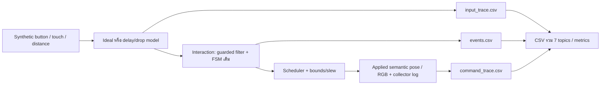
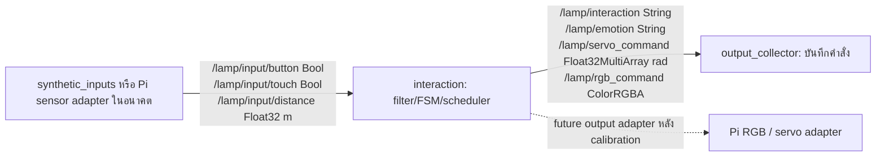
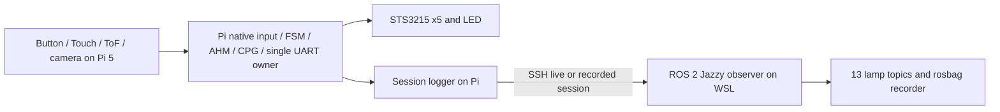

# Graph และ interface — กลุ่ม 7

## ส่วนที่รันแล้ว: offline ใน process เดียว

นี่คือบทบาทจำลอง ไม่ใช่ ROS network ที่รันจริง

## ROS2 graph ตามชุดอาจารย์: ยังไม่ได้รัน

QoS เจ็ด application topics: RELIABLE / KEEP_LAST depth10 / VOLATILE

| Topic | ความหมายและหน่วย |
|---|---|
| /lamp/input/button | Bool true=กด; hardware RAW=0 ที่ขาจริง13/GPIO27ต้องinvert |
| /lamp/input/touch | Bool true=แตะ; hardware RAW=1 ที่ขาจริง15/GPIO22 |
| /lamp/input/distance | Float32 m; VL53L1X cmหาร100; Noneไม่แทน0 |
| /lamp/interaction | String fault/near/clear/touch/button/approach/timeout/idle หรือว่าง |
| /lamp/emotion | String normal/interested/happy/afraid/sleepy |
| /lamp/servo_command | Float32MultiArray rad [tilt,extend,nod]; ยังไม่ใช่คำสั่ง5servoจริง |
| /lamp/rgb_command | ColorRGBA [r,g,b,a], RGB0..1=integer/255, alpha1 |

ตัวอย่าง semantic interested pose = [.22,.18,.06] rad และ RGB = [1,.7058823529,0,1] ไม่ใช้เป็นท่าปลอดภัยของโครงจริง ตัว extend ใน contract เป็นrad ไม่ใช่ระยะเป็นm

## ระบบโคมที่กลุ่มใช้จริง

ระบบนี้ใช้ Pi 5 ควบคุมโคมโดยตรง และ ROS บน WSL ใช้รับ/บันทึกข้อมูล ไม่มี MCU แยกหรือ micro-ROS Agent ไม่ส่งคำสั่งมอเตอร์ผ่าน ROS ไม่ได้กำหนดแผนเพิ่ม ESP32 ในนามกลุ่ม ส่วน offline และ course ROS สาม roles เป็นอีกชุดหลักฐานหนึ่ง แยกจากระบบควบคุมโคมจริง

## Clock boundary

- Offline: รู้ source/sample/publish/receipt/application บน virtual clock เดียว
- ROS: wire messages ไม่มีHeader; sidecar receiptเวลาเฉพาะhost ไม่รู้acquisitionจริง ต้องเพิ่มidentityและclockcorrelationก่อนวัดsource latency
- Hardware: commandส่งแล้วไม่เท่ากับservoเคลื่อน/LEDเปลี่ยน ต้องวัดจริงด้วยฐานเวลาและerrorbound
- Camera: อยู่นอก7topicsนี้ ไม่เพิ่มtrackingหรือเปลี่ยนtopiccontractในงานขั้นต่ำ
