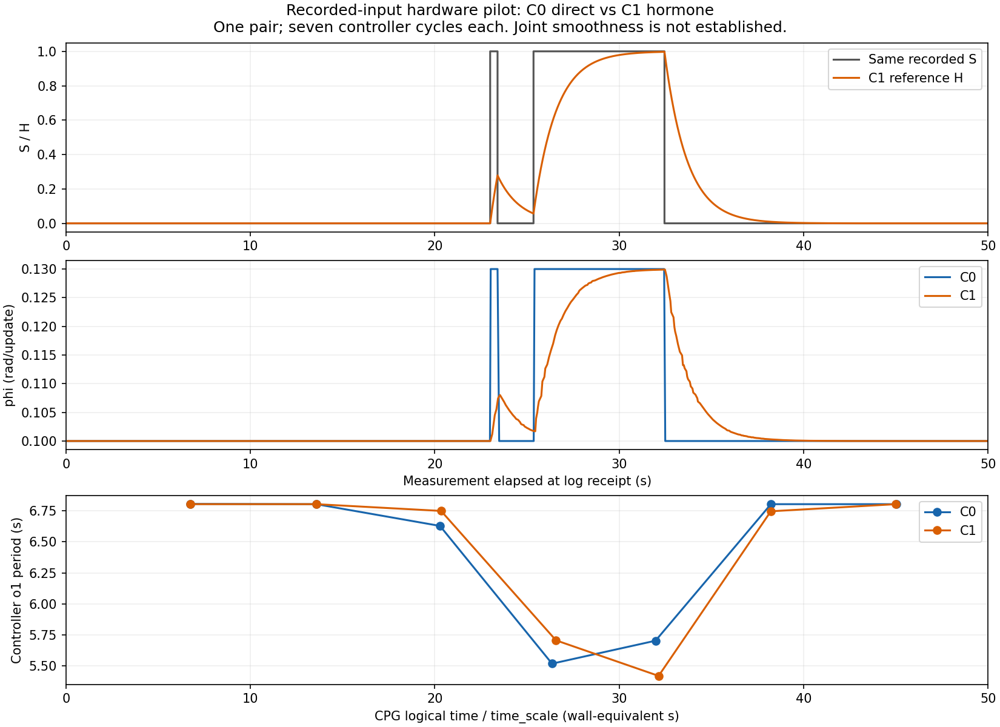
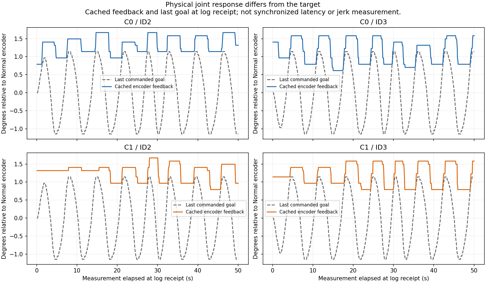

# ผลทดลอง C0/C1 บนโคม — Normal หนึ่งคู่

4 พฤศจิกายน 2026 ผู้ใช้รอครบ50วินาทีและกดQทั้งสองเงื่อนไข ตรวจ input/สถานะ/cleanup และSHA256ไฟล์rawที่คัดจากPiแล้ว

## ผลหลัก

C1 ทำให้phiเปลี่ยนค่อยเป็นค่อยไปกว่าC0 แต่ยังไม่พิสูจน์ว่าการหายใจของมอเตอร์สมูทขึ้น และค่าDeltaTของCPGในคู่นี้ไม่ได้ลดลง

| ตัวชี้วัด | C0 direct | C1 hormone |
|---|---:|---:|
| จำนวนข้อมูลจากตัวควบคุม | 652 | 659 |
| ช่วงphi | 0.100–0.130 | 0.100–0.129910 |
| การเปลี่ยนphiต่อcallbackสูงสุด | 0.030000 | 0.002553 |
| ความถี่เฉลี่ยจากo1 ของตัวควบคุม (Hz) | 0.155311 | 0.155429 |
| mean DeltaT ของตัวควบคุม (s) | 0.428482 | 0.460994 |
| max DeltaT ของตัวควบคุม (s) | 1.109319 | 1.325658 |

maxการเปลี่ยนphiลดลง 91.5% แต่ไม่ใช่เปอร์เซ็นต์ความสมูทของโคม DeltaT=abs(T[n]-T[n-1]) จากคาบo1ที่ข้ามศูนย์ขึ้น คำนวณได้7คาบ/6การเปลี่ยนคาบต่อเงื่อนไข ความถี่อ้างCPG logical clock updates*dt/time_scale ไม่ใช่การวัดความถี่มอเตอร์จริง phiเรียบขึ้นไม่ได้รับรองว่าDeltaTจะลดลงทุกscenario เพราะคาบรวมผลของinputตลอดรอบและphaseขณะได้รับinput

## มอเตอร์จริง

หลัง5วินาทีเพื่อตัดช่วงenvelopeเข้า เป้าหมายID2/3แกว่ง26ticks peak-to-peak (~2.285°) แต่encoder:
- C0: ID2 8ticks (~0.703°), ID3 11ticks (~0.967°)
- C1: ID2 10ticks (~0.879°), ID3 9ticks (~0.791°)

ทั้งสองรอบมีออฟเซ็ตระหว่างเป้ากับมุมจริง และการตอบสนองเล็กกว่าคำสั่ง เป็นหลักฐานว่าผลข้อต่อภายใต้โหลด/การตอบสนองต่อเป้าขนาดเล็กยังเป็นข้อจำกัด แต่ข้อมูลนี้ยังแยกสาเหตุแรงเสียดทาน/backlash/โหลด/ตัวควบคุมภายในไม่ได้ ไม่เพิ่มPIDจากข้อสันนิษฐานนี้ ความเร็ว/jerkจริงยังไม่ได้ประเมินจากกราฟนี้ เพราะfeedbackกับgoalมีเวลาต่างกัน และencoderมีquantization

## สิ่งที่ตรวจได้และข้อจำกัด

- ทั้งสองcompleted=true,cleanup_confirmed=true ทุกแถวNormal/READY ไม่มีNearจริงในtrace
- ใช้inputจริงR08ช่วง80..130วินาทีเหมือนกัน1000samples: S1จำนวน150 ไม่มีinputfaultในfixture; SHAต้นทาง 982bfe603cd9e3be844cab7108fd2fa077eb4fc5c678a52930264689dba969d4
- ค่าเริ่มต้นoscillatorและenvelopeเหมือนกัน แต่encoderเริ่มต้นจริงไม่เท่ากันทุกข้อ (เก็บในmetrics.json)
- ใช้AHMสูตรอาจารย์dt=.05, rates.8/.6/.2,R=H และhardwaremappingphi=.10+.03R ส่วนCPGtime_scale=.5 คงเดิม ต่างจากงานจำลองLab05phi=.20+.20R จึงห้ามรวมเป็นconditionเดียวกันโดยไม่แยกlabel
- ทั้งสองมี359ช่วงพารามิเตอร์อ้างอิงที่ownerข้ามไปเลือกค่าล่าสุด Hอ้างอิงยังคำนวณครบ1000updates แต่ไม่ได้ส่งพารามิเตอร์ทุก50msบนฮาร์ดแวร์ เวลาที่ใช้คำสั่งจริงของสองรอบไม่เหมือนกัน
- มีCPGnodesที่ไม่ปรากฏในlog15/10nodes ใช้linearzero-crossingตามข้อมูลที่เก็บ; independent reconstructionจากSO2ตรงค่าที่เก็บภายใน1.5e-15 ทำให้C0meanDeltaTเปลี่ยนเพียงประมาณ0.00033s ไม่กลับข้อสรุป
- ขณะวัดพักการเปลี่ยนอารมณ์จากidle/Approach/Touch เฉพาะโปรไฟล์ทดลอง แต่STOP/Nearจริง/guardเดิมยังทำงาน โปรไฟล์6อารมณ์เดิมไม่เปลี่ยน
- หนึ่งคู่เป็นpilot ไม่ใช่หลักฐานเชิงสถิติ ไม่ใช่การทดลองคน10นาที และยังไม่ครบแผนLab07ทั้งหมด ไม่ถือว่าทดสอบAHMครบทั้ง6อารมณ์

## ขั้นต่อไป

เก็บซ้ำอย่างน้อยอีก2คู่โดยสลับลำดับC0/C1 และตรวจข้อจำกัดcadence/สถานะก่อนสรุปผลหลัก เน้นคำถามเรื่องความถี่และความต่อเนื่องตามLab07 ส่วนปัญหาCPGมอเตอร์สะอึกเก็บเป็นข้อจำกัดแยก ไม่กลับไปจูนPIDโดยอัตโนมัติ ท่าทาง/PID/ค่า6อารมณ์ที่รับไว้ยังอยู่เดิม ตอนนี้ปิดGUIแล้ว ไม่มีโปรแกรมทดลองมอเตอร์ทำงานต่อ
