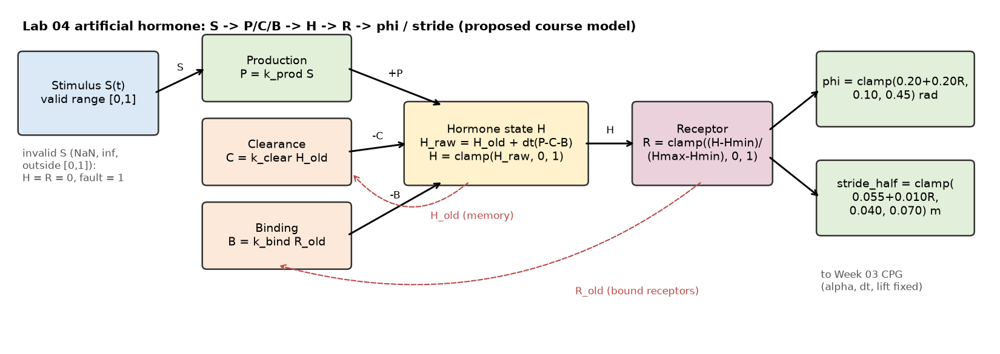

# ใบงาน Lab04 (รายงาน 1–2 หน้า)

ชื่อ นายจิรายุส พลอยพริ้ง   รหัสนักศึกษา 6752500401   วันที่ ______   code version/hash: student_hormone.py SHA256 `d6c3d8cfcabaceca25cfc025d93c65a16439fa9f42bb05ec181c5f66899a67a1` (Python 3.14.2)

## A. ก่อนรัน (10 นาที)

วาด block diagram แล้วเขียนประโยคเชื่อมแต่ละคู่ S, P/C/B, H, R, phi/stride ให้เห็นว่า state เก็บประวัติอย่างไร

S เปิด → P = k_prod·S เพิ่มอัตราสร้าง H; C = k_clear·H_old และ B = k_bind·R_old ใช้ค่าเก่าของ step ก่อน H จึงสะสมและค้างอยู่หลัง S ปิด; H ถูก clamp [0, 1] แล้ว receptor แปลงเป็น R ไปปรับ phi และ stride ผ่าน bounded mapping

> หมายเหตุ: prediction เขียนหลังจากรันโปรแกรมแล้ว จึงเขียนเชิงคุณภาพจากสมการ ตัวเลขอยู่ในคอลัมน์ผลจริงเท่านั้น

| Comparison | prediction ก่อนรัน | เหตุผลจาก term ในสมการ | ผลจริงหลังรัน |
|---|---|---|---|
| C2 vs C1 | H ขึ้นเร็วกว่า แต่น่าจะชน bound 1 | P ใหญ่ขึ้น C, B เท่าเดิม | rise 1.05 s (C1 2.70 s), peak 1.0000 ชน bound 29.0%, AUC 10.6724 (C1 9.9996), recovery 2.85 s เท่ากับ C1 |
| C3 vs C1 | H ลงช้ากว่าหลังปิด stimulus | C = k_clear·H_old เล็กลง | recovery 5.10 s (ช้ากว่า C1 2.25 s), AUC 11.3891 สูงสุด, upper clamp 27.3% |
| C4 vs C1 | H สูงขึ้นและฟื้นช้ากว่าเล็กน้อย | ไม่มี B เหลือ removal แค่ C | rise 1.70 s, recovery 3.80 s, AUC 10.7547, upper clamp 25.8% |
| C0 vs C1 | ตอบสนองทันที ไม่มี memory | R = S ตรง ๆ ไม่มี H | latency 0.05 s, rise 0.00 s, recovery 0.05 s, peak_H = N/A |

เขียนว่า prediction ใดอาจเปลี่ยนเพราะ H มี upper bound=1: “production มากขึ้นหรือ removal น้อยลงแล้ว peak สูงขึ้น” ไม่จริง เพราะ steady state ไม่มี bound ของ C2/C3/C4 = 1.500/1.778/1.333 เกิน 1 จึงถูก clamp ที่ 1.0000 เท่ากัน ต้องดู AUC, rise, recovery, clamp fraction แทน

## B. เติม code และคำนวณมือ (20 นาที)

1. แยก source equation กับ proposed course model คนละกรอบ
2. เติม receptor ก่อน แล้วทดสอบ H=.2, H_min=.1, H_max=.5
3. เติม step: เก็บ H_old และ R_old ก่อนคำนวณ removal
4. เมื่อ H_old=0,S=1 ให้คำนวณ P,C,B,H_raw,H_new,R_new,phi,stride แล้วทำรอบถัดไป
5. รัน checker เก็บ output หากไม่ผ่านให้บันทึก case และเหตุที่แก้

| input_time_s | time_s | P | C | B | H_raw | H | R | phi |
|---:|---:|---:|---:|---:|---:|---:|---:|---:|
|10.00|10.05|0.8000|0.0000|0.0000|0.0400|0.0400|0.0400|0.2080|
|10.05|10.10|0.8000|0.0240|0.0080|0.0784|0.0784|0.0784|0.2157|

receptor(0.2, 0.1, 0.5) = 0.25; checker ผ่าน 13/13 case (`figures/check_submission.png`) ค่าข้างบนคำนวณด้วย python และตรงกับ `results/comparison/C1_step.csv`

แถว CSV ที่เลือกสอดคล้องกับ time convention อย่างไร? time_s คือเวลาหลัง update ส่วน input_time_s คือเวลาต้นช่วงที่ใช้ stimulus update แรกที่ S = 1 ใช้ input_time 10.00 จึงอยู่ที่แถว time_s 10.05 และ update ที่สองอยู่ที่ 10.10 แถวต้นไฟล์ยังเป็นช่วง S = 0

## C. Controlled comparison (20 นาที)

รัน C0–C4 ใช้ dt,duration,H0,stimulus,mapping เดียวกัน เปิด report.html และกรอกค่าจาก metrics.json ไม่อ่านค่าด้วยสายตาอย่างเดียว

| Condition | peak_H | AUC_H | latency s | rise s | recovery s | upper clamp fraction | phi TV rad |
|---|---|---|---|---|---|---|---|
|C0|N/A (ไม่มี H)|N/A|0.05|0.00|0.05|N/A|0.4000|
|C1|0.9997|9.9996|0.15|2.70|2.85|0.0000|0.3998|
|C2|1.0000|10.6724|0.10|1.05|2.85|0.2900|0.3999|
|C3|1.0000|11.3891|0.15|1.45|5.10|0.2733|0.3979|
|C4|1.0000|10.7547|0.15|1.70|3.80|0.2583|0.3995|

ตอบด้วยตัวเลข: C3 ฟื้นช้ากว่า C1 เท่าไร? C2/C3 peak เท่ากันหรือไม่ และ metric ใดแยกสองระบบนี้ได้? C0 มี H หรือไม่? TV ที่ต่ำกว่าเพียงอย่างเดียวพิสูจน์คุณภาพ gait ได้หรือไม่?

- C3 ฟื้นช้ากว่า C1 = 5.10 − 2.85 = 2.25 s
- C2/C3 peak เท่ากันที่ 1.0000 (ชน bound) แยกได้ด้วย rise (1.05 vs 1.45 s), recovery (2.85 vs 5.10 s), AUC (10.6724 vs 11.3891) และ upper clamp (0.2900 vs 0.2733)
- C0 ไม่มี H (peak_H, AUC เป็น N/A)
- TV ต่ำอย่างเดียวพิสูจน์คุณภาพ gait ไม่ได้ เพราะ Lab04 ยังไม่รัน CPG หรือวัด body motion และ TV ไม่บอกจังหวะหรือความเร็วในการตอบสนอง

## D. Extreme tests และ handoff (10 นาที)

รัน zero,one,spike,fault ของ C1 ตรวจว่า spike มี on interval เพียงหนึ่งแถว fault มี flag และ state reset แล้วเริ่มกลับได้ แยก software bounds จาก actuator limits และ emergency stop

ทดลองส่ง contract เดิมของ Week03 ถ้ามี แล้วตรวจ phi/stride ที่ R=0 และ R=1 ระบุสิ่งที่ Lab04 ยังไม่ได้ทดสอบ: ยังไม่ได้รัน CPG/gait, body motion, stability, พลังงาน, actuator limits และหุ่นจริง (ทดลองใน simulator เท่านั้น)

- zero: H = R = 0 ตลอด, phi 0.20, stride 0.055
- one: H เข้าใกล้ 1 (≥0.99 ที่ 5.65 s) ไม่ชน clamp, phi 0.40, stride 0.065 ช่วงท้าย
- spike: S = 1 เพียง 1 แถว (input 10.00, 0.05 s) H สูงสุด 0.0400 แล้วลดลง
- fault: แถว 15.00 H = 0.9831, แถว 15.05 fault = 1 H = R = 0 phi 0.20 stride 0.055, แถว 15.10 H = 0.0400 กลับมาสะสม
- contract จาก Lab03 (`../lab_03/results/week4_bridge/handoff_contract.json`) ตรงเดิม: alpha 1.1, dt 0.05, lift 0.03; R = 0 → phi 0.20 rad, stride 0.055 m; R = 1 → phi 0.40 rad, stride 0.065 m อยู่ใน bounds

## E. สรุปส่งงาน (10 นาที)

เขียน 3 ย่อหน้า: (1) กลไกและ provenance (2) prediction ที่ข้อมูลสนับสนุน/ปฏิเสธพร้อมตัวเลข (3) ข้อจำกัดและการทดลอง Week05 ที่ต้องทำต่อ แนบคำสั่งรันและ config/hash ทุกข้อสรุปต้องอ้าง metric หรือ timestamp

สรุป 3 ย่อหน้าอยู่ในใบงาน Word ส่วน E และรายงาน Lab04_Report_TH.docx

คำสั่งรันซ้ำ: `python lab04.py --controller-source student --condition all --profile step --output-dir results/comparison` และ `--condition C1 --profile zero|one|spike|fault --output-dir results/<profile>`

Checklist: ☑ code ☑ comparison CSV 5 files ☑ extreme CSV 4 files ☑ config ☑ plots ☑ metrics ☑ report (Lab04_Report_TH.docx) ☑ คำสั่งรันซ้ำ
