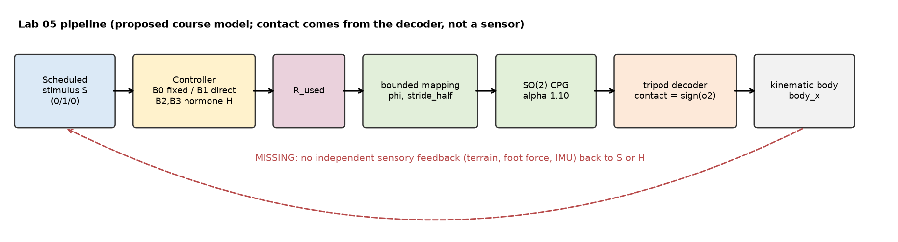

# ใบงาน Lab 05 — Prediction, timing, evidence

ฉบับพิมพ์: [Word](Lab05_Student_Worksheet_TH.docx) / [PDF](Lab05_Student_Worksheet_TH.pdf)

ชื่อ นายจิรายุส พลอยพริ้ง   รหัสนักศึกษา 6752500401   วันที่________

**ขอบเขต:** main runner เป็น proposed course model ใช้ scheduled stimulus และ kinematic body; contact demo ใช้ synthetic signals ไม่ใช่ ALCS terrain experiment ของ paper

## 1. ก่อนรัน: hypothesis และ architecture (10 นาที)

> หมายเหตุ: hypothesis และ prediction เขียนหลังจากรันโปรแกรมแล้ว จึงเขียนเชิงคุณภาพเท่านั้น คำตอบเต็มอยู่ในใบงาน Word

- feedback ที่ขาด: ไม่มี sensor อิสระ (แรงที่เท้า, terrain, IMU) ส่งกลับไปที่ S หรือ H contact มาจาก decoder
- hypothesis B1 vs B2: max Δφ/step (rad) ของ B2 น้อยกว่า B1 มาก, command latency/recovery (s) ของ B2 ยาวกว่า, TV φ (rad) ใกล้กัน
- B3 ตัด binding term (k_bind = 0) แต่ H ยังเป็น state ที่มี memory
- provenance: source = Hc(t) = β·Hc(t−1) + Hg(t) − Hr(t) (Week04/Homchanthanakul 2019); proposed = H_raw = H + dt(P − C − B); expected measurement = segment frequency/distance; วัดไม่ได้ = paper Stability/Harmony/Displacement

1. วาด S→controller→R_used→φ/stride→CPG→decoder→body ของ Lab แล้ววงจุดที่ยังไม่มี independent sensory feedback
2. เขียน hypothesis1 ข้อสำหรับ B1 เทียบ B2 พร้อมตัวชี้วัดและทิศทางที่คาด เช่น TV, latency/recovery, segmentfrequency หลีกเลี่ยงคำว่า “ดีขึ้น” โดยไม่มี metric
3. B3 ตัดอะไรออกจาก B2? สิ่งใดที่ยังคงมี memory?
4. ตาราง provenance: source equation1 รายการ, proposedcourseequation1 รายการ, expectedmeasurement1 รายการ และ metric ที่วัดไม่ได้ 1 รายการ

## 2. รัน comparison และตรวจเวลา (15 นาที)

รัน comparison ตาม README เปิด report เลือก B2 เลื่อน timeline ไป 10.00/10.05s แล้วเปิด B2_states.csv/B2_intervals.csv เพื่อยืนยัน

| command/input time | state end time | H_start | H_end | R_used | φที่ใช้ | stride_half ที่ใช้ |
|---|---|---|---|---|---|---|
| 10.00 | 10.05 | 0.0000 | 0.0400 | 0.0000 | 0.2000 | 0.0550 |
| 10.05 | 10.10 | 0.0400 | 0.0784 | 0.0400 | 0.2080 | 0.0554 |
| 20.00 | 20.05 | 0.9997 | 0.9597 | 0.9997 | 0.3999 | 0.0650 |

อธิบายจาก CSV ว่าเหตุใด B1 command latency กับ state latency จึงต่างกัน: B1 ใช้ S ทันทีใน command 10.00 (latency 0.00 s) แต่ R ใน states เป็นค่าหลัง update จึงเห็นที่ 10.05 (0.05 s) เป็น convention ของ log ไม่ใช่ hardware latency

ตรวจ warmup/initialstates ใน config: ทุก condition เริ่ม CPG เหมือนกันหรือไม่? เหมือนกัน หลักฐาน: initial_states ใน config.json ของ B0–B3 มี o1 = −0.026965, o2 = −0.560863, body_x = 0 หลัง warmup 10 s (α 1.1, φ 0.2)

## 3. เปรียบเทียบผลและข้อจำกัด (15 นาที)

เติมจาก metrics และ segment_metrics พร้อมหน่วย ห้ามคัดลอกผล source paper มาใส่เป็นผล run นี้

| condition | TV φ(rad) | maxΔφ/step(rad) | TV stride(m) | cmd latency(s) | cmd recovery(s) | on frequency(Hz) | on distance(m) |
|---|---|---|---|---|---|---|---|
| B0 | 0.0000 | 0.0000 | 0.0000 | N/A | N/A | 0.6249 | 0.7787 |
| B1 | 0.4000 | 0.2000 | 0.0200 | 0.00 | 0.00 | 1.2684 | 1.8252 |
| B2 | 0.3998 | 0.0080 | 0.0200 | 0.15 | 2.85 | 1.2028 | 1.7063 |
| B3 | 0.3995 | 0.0080 | 0.0200 | 0.15 | 3.80 | 1.2258 | 1.7275 |

1. ผลข้อใดสนับสนุน hypothesis และผลข้อใดไม่สนับสนุน? สนับสนุน: max Δφ/step B2 0.0080 vs B1 0.2000 rad, latency 0.15 vs 0.00 s, recovery 2.85 vs 0.00 s; null: TV φ 0.3998 vs 0.4000 rad และระยะรวม 3.3826 vs 3.3775 m
2. การลด TV ยืนยันว่าหุ่นยนต์ไม่ล้มหรือใช้พลังงานน้อยลงหรือไม่? ขาดข้อมูลอะไร? ไม่ยืนยัน เพราะไม่มี body dynamics, CoM/support polygon, แรงที่เท้า และ energy model
3. Bounds เหมือนกันทำให้ commandamplitude เท่ากันหรือไม่? ใช้ peak/trace ประกอบ: ไม่เท่ากัน B1 peak R 1.0000 ทันที, B2 0.9997 ค่อย ๆ ขึ้น (rise 2.70 s, mean φ on 0.3750), B3 ชน H = 1 (mean φ on 0.3818)
4. ทำไมไม่ใช้ frequency เฉลี่ย 30s แทน pre/on/off? เพราะ φ ต่างกันแต่ละช่วง และยังมี transient (B2 off frequency 0.6982 Hz สูงกว่า pre 0.6249 Hz)

## 4. เปลี่ยนหนึ่งปัจจัยและตรวจ fault (20 นาที)

เลือก phi-only หรือ stride-only ตั้ง prediction ก่อนรัน ตรวจ parameter ที่คงที่จาก intervalCSV แล้วเปรียบเทียบ B1/B2 กับ bothmapping

สิ่งที่เปลี่ยน: φ (phi-only) สิ่งที่คงที่: stride_half 0.055 m metric หลัก: on frequency, on distance prediction: frequency เพิ่มเหมือน both แต่ distance เพิ่มน้อยกว่า

ผลและข้อจำกัด causalclaim: phi-only on frequency B1 1.2684, B2 1.2028 Hz, distance 1.5491, 1.4672 m; stride-only frequency คง 0.6249 Hz, distance 0.9147, 0.9017 m; ผลรวมสองแบบ (0.9063 m) น้อยกว่า both (1.0464 m) มี interaction; เป็น deterministic run เดียวใน kinematic model

รัน faultprofile เปิด input15.00 แล้วบันทึก:

| field | B2 value |
|---|---|
| fault at command15.00 | 1 |
| H_used / R_used | 0.0000 / 0.0000 (h_state_start 0.9831) |
| φ / stride ที่ใช้ | 0.2000 rad / 0.0550 m |
| H state15.05 | 0.0000 |
| H state15.10 | 0.0400 |

อธิบายว่า fallback ทำก่อนหรือหลัง command และเหตุใด policy นี้ยังไม่รับรอง hardware safety: fallback ทำก่อน command ใน interval [15.00, 15.05) เป็นแค่ software fallback ใน simulator φ กระโดด 0.3965 → 0.20 ใน step เดียว และยังไม่ได้ทดสอบ actuator limits หรือ emergency stop

## 5. Contact mini-lab (20 นาที)

เปิด contactreport เลือก cases ด้านล่าง เปรียบเทียบ SI, SIF, absoluteerror และ validity

| case | SI ของแต่ละขาโดยทั่วไป | SIF | absoluteerror | สิ่งที่อนุมานไม่ได้ |
|---|---|---|---|---|
| matched | 1.0000 ทุกขา | 0.0000 | 0.0000 | ไม่บอกว่า sensor ถูก calibrate |
| gain-offset | 1.0000 ทุกขา | 0.0000 | 0.1628 | ขนาดและ offset ของ error |
| mixed-delay | LF/RM/LH 1.0000, RF/LM/RH 0.0000 | 0.5000 | 0.2260 | ขาไหน delay เท่าไร |
| all-inverted | −1.0000 ทุกขา | 0.0000 | 0.6314 | ว่าทุกขาผิดเหมือนกัน (SIF มองไม่เห็น) |
| constant | N/A | N/A | 0.0000 | correlation (variance 0) |

1. ทำไม gain-offset ให้ correlation สูงแม้ error ไม่เป็น 0? Pearson ไม่สน scale/offset actual = 0.2 + 0.5·expected จึงได้ SI 1.0 แต่ MAE 0.1628
2. เมื่อทุกขา inverted ทำไม SIF จึงยังเป็น 0? release ที่ SIF0 มีค่าเท่าไร? ทุกขา SI = −1 เท่ากัน SD จึงเป็น 0; release = 1/(1 + e⁰) = 0.5
3. constant ควรเป็น SI0 หรือ N/A? N/A เพราะ variance 0 หาร Pearson ไม่ได้ (valid rows 0)
4. fault หนึ่ง sample มีผลต่อ rollingwindows กี่ rows ไม่นับ startup49rows? ตรวจ CSV: 50 rows (15.00–17.45 s, nonfinite_window) รวม unavailable 99 rows
5. pairedPearson ของ demo มีสถานะ source/proposed ใด? ต่อ Cg/MI แล้วหรือยัง? เป็น proposed course definition ไม่ใช่ printed Eq.(3) ของ paper และยังไม่ต่อ C_g/HR/MI_H

## 6. ส่งงานและ exit ticket (10 นาที)

ส่ง prediction ก่อนรัน, config/manifest/rawCSV ของ comparison+one-factorrun+fault, contactmetrics และ CSV หนึ่ง case ที่อภิปราย, ตารางพร้อมหน่วยและกราฟ 2 รูป พร้อมรายงาน 2–3 หน้า บอกคำสั่งและ Pythonversion เพื่อรันซ้ำ

Exit: เขียนหนึ่ง claim ที่ข้อมูลรองรับ และหนึ่ง claim ที่ยังรองรับไม่ได้ พร้อมชื่อ metric/ข้อมูลที่ต้องเพิ่ม

- รองรับ: B2 max Δφ/step 0.0080 rad เทียบ B1 0.2000 rad และ command recovery 2.85 vs 0.00 s (step profile)
- ยังไม่รองรับ: B2 ทำให้หุ่นเสถียรหรือประหยัดพลังงานกว่า ต้องเพิ่ม CoM/support polygon, แรงที่เท้า, IMU, energy
- รายงาน 2–3 หน้าอยู่ใน Lab05_Report_TH.docx

**Rubric20 คะแนน:** architecture/provenance4; timing/fault4; reproducibility/data3; quantitativecomparison/one-factor5; interpretation/contact/N/A4 คะแนนมาจากเหตุผลกับหลักฐาน ไม่ได้ให้เต็มเพราะ runner รันผ่านหรือเพราะผล “ดีขึ้น” ตามคาด

**Workshop 25 นาทีในคาบ Week05:** ทำข้อ 1 แบบย่อ 5 นาที, ข้อ 2 10 นาที, ข้อ 3 10 นาที ส่วน one-factor/fault/contact เป็น extended lab หรือการบ้าน ใช้เวลารวม 90 นาทีตามใบงาน ไม่รวมเวลาติดตั้ง Python
